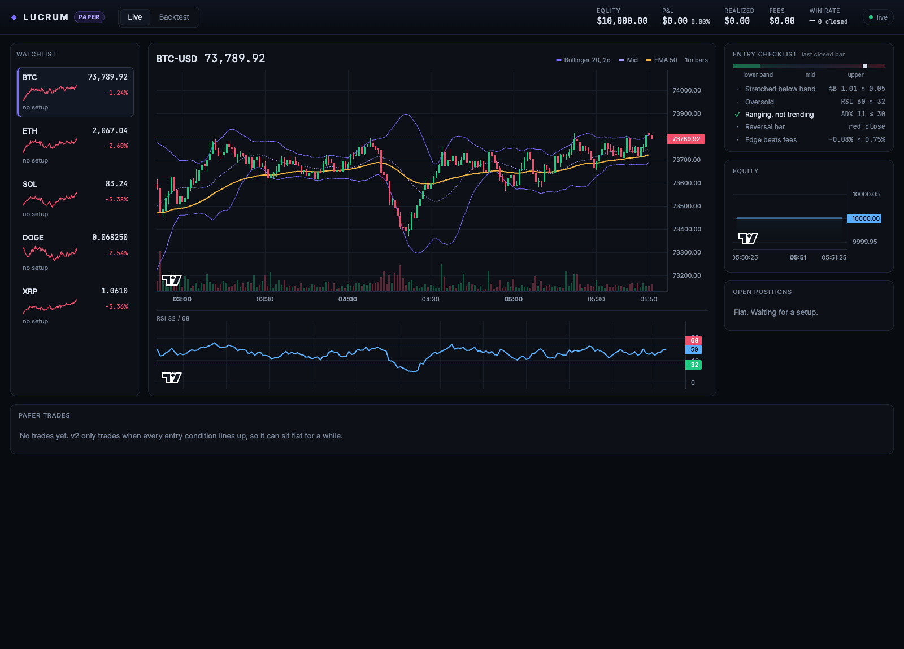

# Paper Trading Agents

Coinbase crypto mean-reversion trader with a live web dashboard. **Paper trading only**: no real orders are placed.



## Quick start
```bash
python3 -m venv .venv && .venv/bin/pip install -r requirements.txt
cd dashboard && npm install && npm run build && cd ..
.venv/bin/python -m lucrum.server          # open http://localhost:8000
```
Options: `--granularity 300` (5-minute bars), `--products BTC-USD SOL-USD`, `--auto` (pick coins by liquidity-weighted volatility), `--cash 10000`, `--fee 0.0025`.

Backtest from the terminal (compares v2 against the original Bollinger.py rules):
```bash
.venv/bin/python -m lucrum.backtest --granularity 900 --bars 1500
```
For frontend development, run `npm run dev` in `dashboard/` (proxies to the Python server on :8000).

## Layout
| Path | What |
|---|---|
| `lucrum/data.py` | Coinbase public REST (paginated candles, products) + coin selector |
| `lucrum/indicators.py` | Bollinger, %B, Wilder RSI, EMA, ATR, ADX |
| `lucrum/strategy.py` | `MeanReversionV2` (new) and `LegacyBollinger` (port of the old rules) |
| `lucrum/backtest.py` | Bar-by-bar backtester, next-bar-open fills, fees, stops |
| `lucrum/engine.py` | Live engine: websocket ticker → OHLC bars → strategy → paper broker |
| `lucrum/server.py` | FastAPI: `/ws` live stream, `/api/snapshot`, `/api/backtest`, serves the dashboard |
| `dashboard/` | React + TradingView lightweight-charts UI |
| `legacy/` | Original scripts (Bollinger.py, RSI.py, EMA.py, cryptoselect.py, ...) |

## What changed in the algorithm (v2)
Bugs and weaknesses in the original scripts:
- **Bollinger.py** polled the ticker once every 5 minutes (`interval=300000`) and built bands from those single prints, not OHLC bars. History was never trimmed, and the Excel file was rewritten on every tick.
- **Exits**: "Only sell above purchase price" with no stop loss means a losing trade is held indefinitely. Sizing was effectively all-in.
- **RSI.py** used a simple-mean RSI instead of Wilder's smoothing.
- **cryptoselect.py** crashed: `SIGNAL_CHECK` etc. were only assigned inside `main()`, so `generate_signal` raised `NameError`. It also ranked fiat currencies from `/exchange-rates`, never refreshed prices inside the loop, and called an endpoint that needs auth.
- **Fees**: Coinbase fees were ignored entirely. At 0.25–0.6% per side, most 1-minute band touches cannot pay for the round trip.

v2 rules (all tunable in `lucrum/config.py`):
- **Entry** requires all of the following on a closed bar:
  - %B ≤ 0.05
  - RSI ≤ 32
  - ADX ≤ 30 (ranging market, not a trend)
  - a green reversal bar
  - the expected move back to the mid band ≥ 1.5 × the round-trip fee
- **Exit** on any of these:
  - %B ≥ 0.55 (back to the mid band)
  - RSI ≥ 68
  - a 2×ATR hard stop, checked on every tick
  - a 60-bar time stop
- **Sizing**: risk 1% of equity per trade based on the stop distance, with at most 25% of equity in one coin.

### Backtest snapshot (Nov 2026, 15-min bars, ~15 days, 0.25% fee per side, falling market)
| | v2 | legacy | buy & hold |
|---|---|---|---|
| BTC-USD return | -0.40% | -9.39% | -8.08% |
| BTC-USD max drawdown | -0.40% | -10.41% | |
| SOL-USD return | -0.42% | -17.77% | -18.58% |
| SOL-USD max drawdown | -1.05% | -19.36% | |

v2 is mainly a capital-preservation upgrade so far. It refuses most trades the old logic took, and fees were the main thing killing those. It is **not yet shown to be profitable**, so test across more market regimes before any real money is involved.
